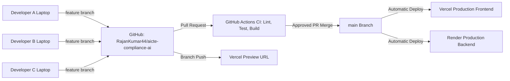

# Team Development & Synchronization Workflow

## Overview
This document specifies how all developers collaborating on **AICTE Compliance AI** keep their local working trees, remote branches, and deployments synchronized without regressions or laptop-specific configuration drift.

---

## 1. Golden Architecture & Single Source of Truth



### Critical Rules:
1. **Never use personal forks as the deployment target:** All team feature branches must be pushed directly to `origin` (`RajanKumar44/aicte-compliance-ai`) or synced with upstream via approved PRs.
2. **Never commit secrets:** All sensitive database keys, service-role tokens, or environment overrides stay in `.env.local` or environment dashboards.
3. **Always verify `/api/v1/me`:** When testing authentication, visit `/session-check` in your browser to verify that your session is validated by the server and visible to PostgreSQL RLS.

---

## 2. Standard Branching Convention

| Branch Pattern | Purpose | Base Branch | Merge Target |
| :--- | :--- | :--- | :--- |
| `main` | Production release branch | N/A | Production Deploy |
| `feature/<feature-name>` | New user-facing or backend capability | `main` | `main` |
| `fix/<defect-name>` | Bug fix or regulatory correction | `main` | `main` |
| `devops/<infra-name>` | CI/CD pipeline or deployment update | `main` | `main` |
| `docs/<topic-name>` | Documentation or compliance handbooks | `main` | `main` |

---

## 3. Step-by-Step Developer Commands

### Starting a Task
```bash
git checkout main
git pull --ff-only origin main
git checkout -b feature/compliance-action-filters
```

### Developing & Incremental Commits
```bash
# Check status frequently
git status

# Stage clean files
git add frontend/app/src/pages/ActionPlannerPage.tsx
git commit -m "feat(action-planner): add department filter chip"

# Push to your feature branch on origin
git push -u origin feature/compliance-action-filters
```

### Refreshing an Existing Branch Against Latest `main`
```bash
git fetch origin
git checkout feature/compliance-action-filters
git merge origin/main

# If conflicts arise:
# Inspect conflicted files, preserve canonical logic, run tests:
npm --prefix frontend/app test
python -m pytest -q backend/tests

# Finalize merge
git add .
git commit -m "chore: sync feature branch with origin/main"
git push origin feature/compliance-action-filters
```

### Cleaning Up After PR Merge
```bash
git checkout main
git pull --ff-only origin main
git branch -d feature/compliance-action-filters
git fetch origin --prune
```
