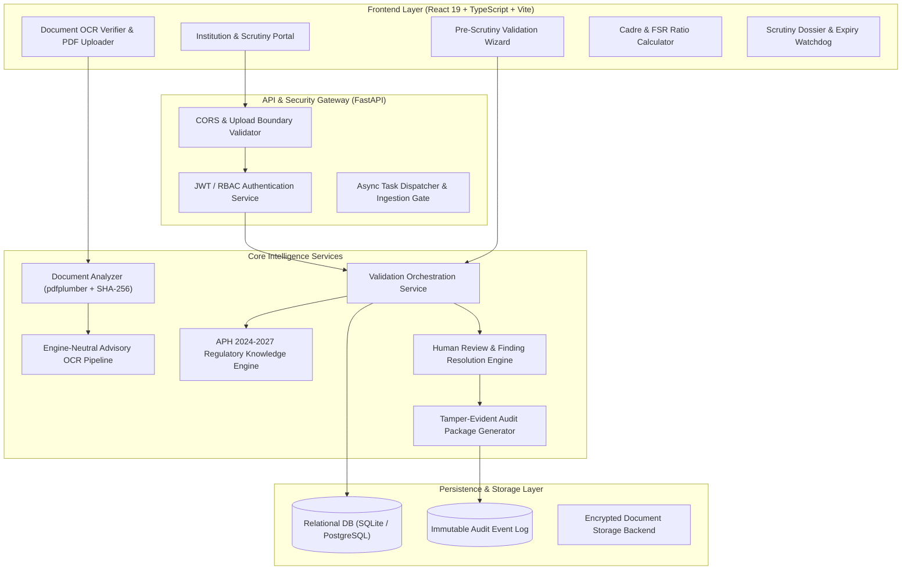

# AICTE Compliance Assistant (SIH Problem Statement: SIH26261)

[]()
[]()
[]()
[]()
[]()

> **Smart India Hackathon (Ministry of Education / AICTE)**  
> **Problem Statement ID:** SIH26261  
> **Topic:** AI-Powered Platform to Validate Institutional Records, Authenticate Documents, and Assist in AICTE Regulatory & Infrastructure Compliance.

---

## 📌 Executive Summary

Every year, the **All India Council for Technical Education (AICTE)** processes thousands of institutional applications for **Extension of Approval (EoA)**, **New Programs**, and **Intake Variations**. The sheer volume and diversity of supporting documents (structural stability certificates, land lease deeds, fire safety NOCs, faculty rosters, affidavits) create administrative bottlenecks, processing delays, and repetitive manual scrutiny.

The **AICTE Compliance Assistant** is a secure, role-based, AI-enabled **pre-scrutiny decision-support platform** designed to integrate with the AICTE web portal. It automatically:
1. Validates application checklists and document completeness against the **Approval Process Handbook (APH 2024–2027)**.
2. Extracts critical metadata and validity dates from PDF certificates using intelligent text analysis and OCR.
3. Detects anomalies, duplicate submissions, and inconsistent institutional identifiers across document slots.
4. Calculates **Cadre Ratios and Faculty-to-Student Ratios (FSR)** to identify staffing deficiencies.
5. Provides a traceable, explainable scrutiny workflow for Scrutiny Officers, ending with **tamper-evident, cryptographically signed audit packages**.

> [!IMPORTANT]
> **Advisory Invariant:** Automated findings are decision-support outputs. Statutory authority, physical inspection decisions, and final regulatory approval remain exclusively with competent AICTE committees.

---

## 🚀 Live Demo & Quick Links

- 🌐 **Live Web Application:** [https://aicte-compliance-ai.vercel.app](https://aicte-compliance-ai.vercel.app)
- 🔌 **Backend API Preview:** [https://aicte-compliance-api-preview.onrender.com](https://aicte-compliance-api-preview.onrender.com)
- 📖 **Interactive API Docs (Swagger):** [https://aicte-compliance-api-preview.onrender.com/docs](https://aicte-compliance-api-preview.onrender.com/docs)
- 🔑 **1-Click Demo Accounts (on Sign-In Page):**
  - **Institution Administrator:** `admin@demo.aicte.gov.in` (pre-scrutiny submission & self-assessment)
  - **Scrutiny Officer / Reviewer:** `reviewer@demo.aicte.gov.in` (finding resolution, waiver & audit sign-off)

---

## 🏛️ System Architecture



---

## 🌟 Key Features & Functional Modules

### 1. Intelligent Application Pre-Scrutiny & Checklists
- Categorizes submissions by application type: **Extension of Approval (EoA)**, **New Program**, and **Intake Change**.
- Dynamic checklist verification comparing required statutory documents against submitted portfolios.
- **Nil Deficiency Gap Predictor:** Generates institutional readiness scores and suggests prescribed AICTE mitigation undertakings for non-statutory deficiencies.

### 2. PDF Document Analysis & Advisory OCR
- Endpoint: `POST /api/v1/documents/analyze`.
- Enforces a 10 MiB upload safety limit, checks PDF structural integrity, and extracts candidate fields:
  - **Issue Date & Expiry Date** (normalized to strict ISO `YYYY-MM-DD`).
  - **Certificate / NOC Reference Number**.
  - **Issuing Authority** (Fire & Emergency Services, Municipal Corporations, Land Revenue Sub-Registrars).
- Computes SHA-256 cryptographic hashes for document provenance.

### 3. Anomaly & Potential Tampering Detection
- **Duplicate Document Detection (`CHECK_DUPLICATE_FILES`):** Flags instances where an identical document is reused across different checklist slots.
- **Chronological Date Inversion (`CHECK_DATE_ORDER`):** Flags documents where the issue date is recorded after the expiration date.
- **Institutional Identity Mismatch (`CHECK_INSTITUTION_CONSISTENCY`):** Flags documents where extracted institution identifiers conflict with the registered application profile.
- **Cross-Document Inconsistency (`CHECK_CROSS_DOCUMENT_CONSISTENCY`):** Flags conflicting institutional names across different uploaded blocks.

### 4. APH 2024–2027 Regulatory Knowledge & Cadre Calculator
- Complete statutory clause citations embedded in the frontend knowledge base:
  - **Clause 2.4:** Fire and Life Safety Clearance (Zero-tolerance).
  - **Clause 2.6:** Structural Soundness Certification (Zero-tolerance).
  - **Clause 2.5:** Building Occupancy & Completion Certificate.
  - **Clause 1.7:** Contiguous Land Ownership / 30-Year Registered Lease.
  - **Clause 4.2:** Programmatic NBA Accreditation Norms.
- **Interactive Cadre & Faculty-to-Student Ratio (FSR) Calculator:**
  - Evaluates compliance against AICTE norms for Engineering (UG 1:20 / 1:15 autonomous, PG 1:15), Management (1:20), MCA (1:20), and Pharmacy.
  - Detects Cadre distribution imbalances (Professor : Associate Professor : Assistant Professor at 1:2:6).
  - Flags shortfalls in Ph.D.-qualified faculty for senior cadre posts.

### 5. Scrutiny Workflow, RBAC & Audit Packages
- Role-based access control with granular permissions: `institution_admin`, `scrutiny_officer`, and `auditor`.
- Scrutiny Officer finding lifecycle (`pending` $\rightarrow$ `under_review` $\rightarrow$ `confirmed` / `waived` / `rectified`).
- Optimistic concurrency control and client request idempotency.
- Exportable, tamper-evident audit packages (`.zip`) containing verifiable JSON manifests, cryptographic hash trees, and chronological audit action histories.

---

## 🛠️ Technology Stack

| Layer | Technology |
|---|---|
| **Frontend** | React 19, TypeScript, Vite, Tailwind CSS v4, Lucide React, Oxlint |
| **Backend API** | FastAPI, Pydantic v2, Python 3.11+, Uvicorn, Starlette |
| **Data Extraction & OCR** | pdfplumber, Tesseract OCR Adapter, Regex Normalizers |
| **Database & ORM** | SQLAlchemy 2.0, Alembic Migrations, SQLite (dev) / PostgreSQL (prod) |
| **Background Processing** | Celery / In-Memory Eager Dispatcher |
| **Testing & QA** | Pytest, Node Test Runner, Ruff Linter, TestClient |

---

## 💻 Local Setup & Execution

### Prerequisites
- **Python 3.11+** installed (`python --version`)
- **Node.js 18+** and **npm** installed (`node --version`)
- *(Optional)* Tesseract OCR system binary for local image OCR testing

---

### Step 1: Clone and Set Up Backend

```bash
# Clone the repository
git clone https://github.com/rajaryan1111/aicte-compliance-ai.git
cd aicte-compliance-ai

# Create and activate Python virtual environment
python -m venv .venv
# Windows:
.venv\Scripts\activate
# Linux/macOS:
source .venv/bin/activate

# Install dependencies
python -m pip install -r backend/requirements.txt -r backend/requirements-dev.txt

# Run migrations / verify local SQLite database
python -m alembic -c backend/alembic.ini stamp head

# Start the FastAPI backend server
python -m uvicorn backend.app.main:app --host 127.0.0.1 --port 8000 --reload
```

The backend is now live at [http://127.0.0.1:8000](http://127.0.0.1:8000).  
Interactive Swagger docs: [http://127.0.0.1:8000/docs](http://127.0.0.1:8000/docs).

---

### Step 2: Set Up and Start Frontend

In a new terminal window:

```bash
cd frontend/app

# Install dependencies (already locked via package-lock.json)
npm install

# Start Vite development server
npm run dev
```

The frontend will start at [http://localhost:5173](http://localhost:5173).  
All requests to `/api` and `/health` are automatically reverse-proxied to the local backend at port 8000.

---

### Step 3: Run Full Test Suite

```bash
# Run backend test suite (389 tests)
python -m pytest backend/tests -q

# Run synthetic AI extraction benchmark
python ai/evaluate_extraction.py

# Verify live API against frontend contract fixtures
python frontend/tools/verify_fixtures.py

# Lint checks
python -m ruff check backend/ ai/ frontend/ tools/

# Run frontend unit tests
cd frontend/app
npm test
```

---

## 📋 Evaluation & Hackathon Scoring Alignment

| Evaluation Criteria | How This Solution Delivers |
|---|---|
| **Novelty & Innovation** | Combines rule-based APH governance, dynamic Cadre calculators, document OCR metadata extraction, and hash-based fraud anomaly detection in a single unified dashboard. |
| **Feasibility & Usability** | Clean React 19 UI with multi-step validation wizard, instant demo accounts, PDF upload analysis, and pre-filled statutory document presets. |
| **Traceability & Explainability** | Every finding links directly to the observed field, document hash, evaluation timestamp, and specific AICTE handbook clause. No "black-box" decisions. |
| **Regulatory Realism & Safety** | Respects legal boundaries: outputs are strictly advisory, never purporting to replace Standing Hearing Committees or physical inspections. |
| **Code Quality & Testing** | Over 389 unit, integration, and security tests passing with zero lint warnings across both Python and TypeScript codebases. |

---

## 👥 Contributors & SIH Team

- **Repository:** [rajaryan1111/aicte-compliance-ai](https://github.com/rajaryan1111/aicte-compliance-ai)
- **Problem Statement:** SIH26261 — AICTE Approval Scrutiny Assistant

---

## 📜 License & Compliance Notice

This software is developed exclusively for the Smart India Hackathon as an advisory decision-support prototype. It operates on synthetic test data and caller-supplied parameters. It does not access restricted government databases or issue statutory regulatory verdicts.
