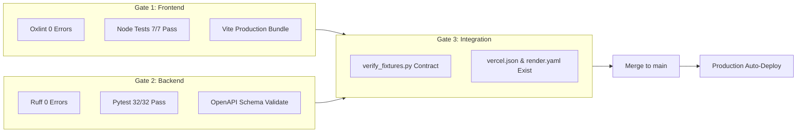

# Release & Deployment Process

## Overview
Every approved commit on `main` triggers automatic, zero-downtime production deployments to Vercel (Frontend) and Render (Backend). This document outlines the release gates, monitoring, and rollback strategies.

---

## 1. Automatic CI/CD Pipeline Gates

Before any change reaches the production `main` branch, the GitHub Actions CI pipeline enforces three mandatory gates:



### Required Status Checks
- `Frontend Lint, Test & Build`
- `Backend Lint, Test & Schema Validation`
- `Monorepo Integration & Deployment Config Checks`

---

## 2. Monorepo Path Filtering & Trigger Matrix

| Change Path | Vercel Deployment | Render Deployment |
| :--- | :---: | :---: |
| `frontend/app/**` | **YES** (Automatic) | NO |
| `backend/app/**` | NO | **YES** (Automatic) |
| `supabase/migrations/**` | NO (Manual Supabase Apply) | NO |
| `vercel.json` / `render.yaml` | **YES** | **YES** |
| `.github/workflows/**` | Validated in CI | Validated in CI |

---

## 3. Post-Deployment Verification

After merging to `main`, release engineers must verify the live production endpoints:

### 1. Verify Backend Health & Commit SHA
```bash
curl -s https://aicte-compliance-backend-live.vercel.app/version
```
Expected response:
```json
{
  "service": "aicte-compliance-assistant",
  "version": "0.5.0",
  "environment": "production",
  "commit_sha": "<7-character-commit-hash>",
  "build_time": "..."
}
```

### 2. Verify Frontend TopBar Diagnostic Pill
Open `https://aicte-compliance-ai.vercel.app/` and inspect the top-right version badge:
- Badge should display: `v0.5.0 • <commit-sha>`.
- Click on `/session-check` to confirm real Supabase backend connection.

---

## 4. Emergency Rollback Protocol

If a defective release slips through to production:

```bash
# 1. Locate the last known good commit SHA on main
git log --oneline -n 10

# 2. Create a revert commit (never force-push)
git checkout main
git pull origin main
git revert <bad-commit-sha> -m "revert: rollback bad commit to restore production stability"

# 3. Push revert commit to main
git push origin main
```
Both Vercel and Render will detect the revert commit and immediately deploy the prior working state.
